<picture>
  <source media="(prefers-color-scheme: dark)" srcset="assets/hero-dark.svg">
  
</picture>

  <a href="https://piyushjaiswal.com"><b>piyushjaiswal.com</b></a>&nbsp;&nbsp;·&nbsp;&nbsp;<a href="https://x.com/pi_jaiswal">x / @pi_jaiswal</a>&nbsp;&nbsp;·&nbsp;&nbsp;<a href="https://piyushjaiswal.com/notes">notes</a>&nbsp;&nbsp;·&nbsp;&nbsp;<a href="https://piyushjaiswal.com/blog">articles</a>

### ~/now

<table>
<tr>
<td width="50%" valign="top">
<a href="https://github.com/pjx16/sdlc-agent">
<picture>
  <source media="(prefers-color-scheme: dark)" srcset="assets/sdlc-agent-dark.svg">
  
</picture>
</a>

**[sdlc-agent](https://github.com/pjx16/sdlc-agent)** &nbsp;`active`

A self-hosted engine that turns Jira tickets into reviewable, test-first pull requests. AI plans, you approve, and sandboxed agents ship one PR per ticket.

TypeScript · NestJS · Next.js · PostgreSQL · Docker · Claude Code
</td>
<td width="50%" valign="top">
<a href="https://github.com/pjx16/minidb">
<picture>
  <source media="(prefers-color-scheme: dark)" srcset="assets/minidb-dark.svg">
  
</picture>
</a>

**[miniDB](https://github.com/pjx16/minidb)** &nbsp;`active`

A small storage engine written from scratch in Go, built from the lowest layer up to learn what actually happens below the query.

Go · pages · heap files · on-disk layout
</td>
</tr>
</table>

### ~/stack

  <a href="https://skillicons.dev">
    <picture>
      <source media="(prefers-color-scheme: dark)" srcset="https://skillicons.dev/icons?i=ts,go,nodejs,nestjs,nextjs,react,postgres,mongodb,docker,git&theme=dark&perline=10">
      
    </picture>
  </a>

<b>~/principles</b>

 

- **Speed only counts if it ships well.** Tested, reviewed, maintainable, or it isn't done.
- **Learn a layer by building it.** Reading about a storage engine isn't the same as writing one.
- **Write it down.** What worked, what didn't, and why, on [the blog](https://piyushjaiswal.com/blog).

<picture>
  <source media="(prefers-color-scheme: dark)" srcset="assets/divider-dark.svg">
  
</picture>

<code>while true; do read &amp;&amp; build &amp;&amp; write; done</code>

